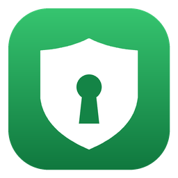
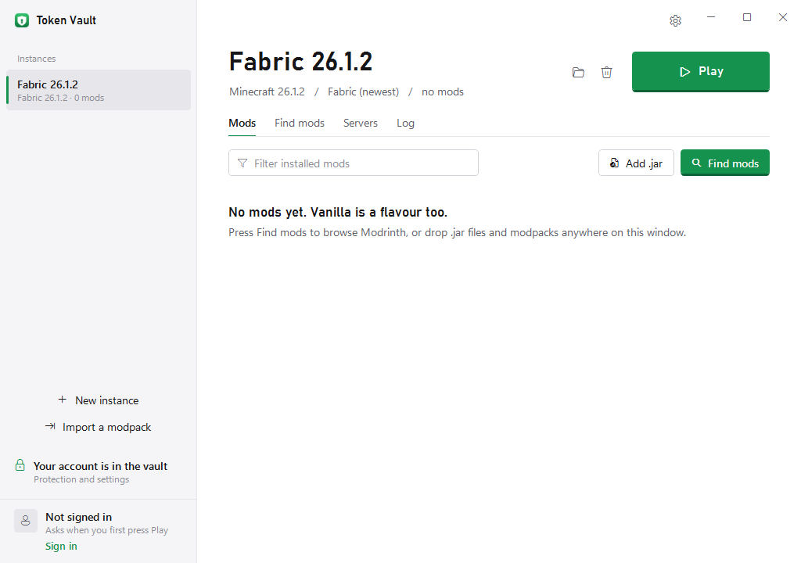
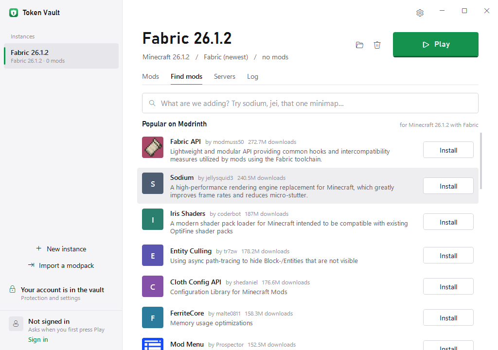
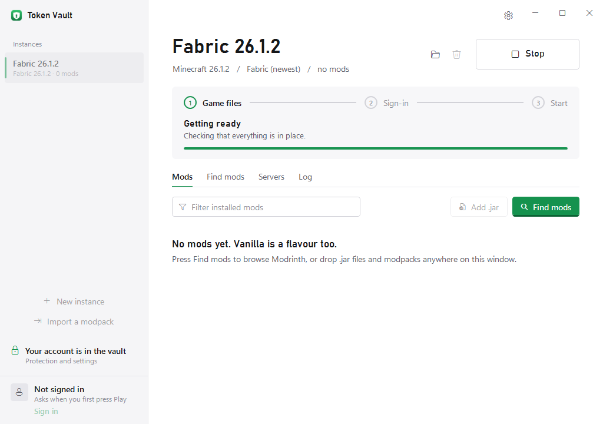

<p align="center">
  
</p>

<h1 align="center">Token Vault</h1>

<p align="center">A Minecraft launcher for Windows that keeps your account away from the mods you run.</p>

<p align="center">
  
</p>

Most stolen Minecraft accounts go the same way. Someone installs a mod that looks fine, the mod reads the sign-in
token the game keeps in memory (or the files other launchers save), and sends it off. Whoever receives it can play
as you, and with the right token, take the Microsoft account too.

Token Vault runs Minecraft and every mod inside a Windows sandbox and never hands the game your real sign-in. It
keeps that itself, encrypted, and does the parts of signing in that need it. You install mods the way you're used
to, press Play, and join servers from the normal multiplayer list.

It's an early release. Vanilla and Fabric are tested end to end on Windows, including online-mode servers. Quilt,
Forge and NeoForge work but are less tested.

## Getting started

1. Download `TokenVault-win-x64.zip` from the [latest release](../../releases/latest) and unzip it somewhere you can
   write to, like your Downloads or Documents folder. Program Files won't work, because Token Vault updates itself.
2. Open `TokenVault.exe`. The first time, Windows SmartScreen may say it doesn't recognise the app. Choose
   **More info**, then **Run anyway**.
3. One page of setup: a one-time Windows approval for the sandbox, signing in with Microsoft in your browser, and
   whether to share anonymous statistics. Skip anything; it's all under the gear later.

After that, pick an instance on the left and press Play. Minecraft, Java and the mod loader download from Mojang
and the loader's own servers the first time, and every file is checked against the hash its publisher lists.

To add mods, open **Find mods**: it searches Modrinth for mods that fit that instance's Minecraft version and
loader, and installs what they need (Fabric API, for example) along with them. You can also drop `.jar` files or a
whole modpack onto the window. Modrinth (`.mrpack`), CurseForge, Prism and MultiMC exports and ordinary archives
all work, and each pack becomes its own instance with the right version and loader.

Add your servers on the **Servers** tab. They show up in Minecraft's multiplayer list.

<p align="center">
  
  
</p>

## How it protects you

**The game gets a stand-in.** Minecraft starts with a random token that only works against Token Vault itself.
If a mod steals it, it's useless. When the game needs your profile, skin or chat key, it asks Token Vault, which
answers a short fixed list of requests and refuses the rest, including name and skin changes.

**Token Vault does the server sign-in.** The game connects to Token Vault, which signs in to the real server and
passes the game traffic through. The secret that ties a sign-in to one connection is made and kept by Token Vault,
so a mod can't ask it to sign in somewhere else. Only the game's own process can use these connections, and
before each join Token Vault asks you in its own window, which the game can't click.

**The sandbox.** Minecraft runs in an AppContainer, the same kind of Windows sandbox browsers and Store apps use.
It can't open your documents, your browser's data or other launchers' saved sign-ins, can't read Token Vault's
memory, and by default can't read your clipboard.

**Your saved sign-in** is encrypted with a key held by your PC's TPM chip and Windows. A copy of the file is useless
on another computer, and signing out destroys the key. On a PC without a TPM, Windows' own encryption (DPAPI) is
used instead, which someone with your Windows password could open.

The details, including the threat model and the cryptography, are in [docs/CRYPTOGRAPHY.md](docs/CRYPTOGRAPHY.md).

## What it can't do

Be clear about these before trusting it with an account you care about.

- **While you're on a server, a bad mod is in control of that connection.** It can chat, trade, give items away or
  quietly hand the connection to someone else, who plays as you there until you disconnect. Anything done in that
  time can stick. If something looks wrong, press **Disconnect** at the top of Token Vault. What a mod can't do is
  sign in as you later.
- **Signed chat.** On Minecraft 1.19 and newer, the game needs a chat-signing key, and a mod can copy it and sign
  chat as you for about two days. Turn signed chat off in Protection (bottom left) if your servers don't require it.
- **Servers you add** are trusted to be what they say. A malicious one can pass your sign-in on to a different server.
- **Malware already on your PC** that runs as you (outside the sandbox) can read whatever you can.
- **Other launchers** don't protect you. Play these mods in Token Vault.
- **Realms and server transfers** don't work, since both need the game to sign in by itself.
- **Signing out doesn't cancel the sign-in at Microsoft.** To do that, remove the app at
  [account.live.com/consent/Manage](https://account.live.com/consent/Manage).

## Updates and privacy

Token Vault checks this repository's releases when it starts and every few hours. A new version downloads in the
background and is installed only if it carries Token Vault's release signature. It runs the next time you open the
app. You can turn this off under the gear.

Usage statistics are off unless you say yes during setup or under the gear. If you do, Token Vault sends anonymous
events to PostHog: app and Windows version, which Minecraft version and loader you launch, and whether launches and
joins work. Never your account, servers, mods or files. Searching Modrinth sends what you type, plus the instance's
Minecraft version and loader, to Modrinth.

Your settings and saved sign-in live in `%LOCALAPPDATA%\TokenVault\Data`. Games, instances and mods live in
`C:\TokenVault`. To uninstall, delete both folders and `TokenVault.exe`. To also remove the sandbox's network
exemption, run `CheckNetIsolation LoopbackExempt -d -n=TokenVault.MinecraftSandbox` as administrator.

## Building

You need the .NET 8 SDK on Windows.

```powershell
dotnet build TokenVault.sln -c Release
dotnet run --project tests/TokenVault.Tests -c Release
./scripts/Build.ps1        # tests, then a single-file exe in artifacts/TokenVault
```

| Project | What's in it |
|---|---|
| `TokenVault.App` | The window: instances, play, mods, servers, protection and settings, first-run setup |
| `TokenVault.Vault` | Microsoft sign-in, encrypted storage, the local API, the server login broker, updates |
| `TokenVault.Launcher` | Game installer, sandbox, folder permissions |
| `TokenVault.Packs` | Modpack and archive import, Modrinth search and install |
| `TokenVault.Core` | Settings, Minecraft protocol and crypto, envelope encryption |

Screenshots in `docs/screenshots` are taken by CI, which runs the real app on Windows and clicks through it.

## More

- [docs/CRYPTOGRAPHY.md](docs/CRYPTOGRAPHY.md): design, threat model and analysis
- [docs/ALLOWLIST.md](docs/ALLOWLIST.md): exactly which account requests the game may make
- [docs/ACCEPTANCE.md](docs/ACCEPTANCE.md): manual checks before a release
- [docs/VALIDATION.md](docs/VALIDATION.md): what has been tested, and how

MIT licensed. Not affiliated with Mojang or Microsoft. No Mojang, Microsoft, Fabric or Java files are included;
they're downloaded from their publishers.
